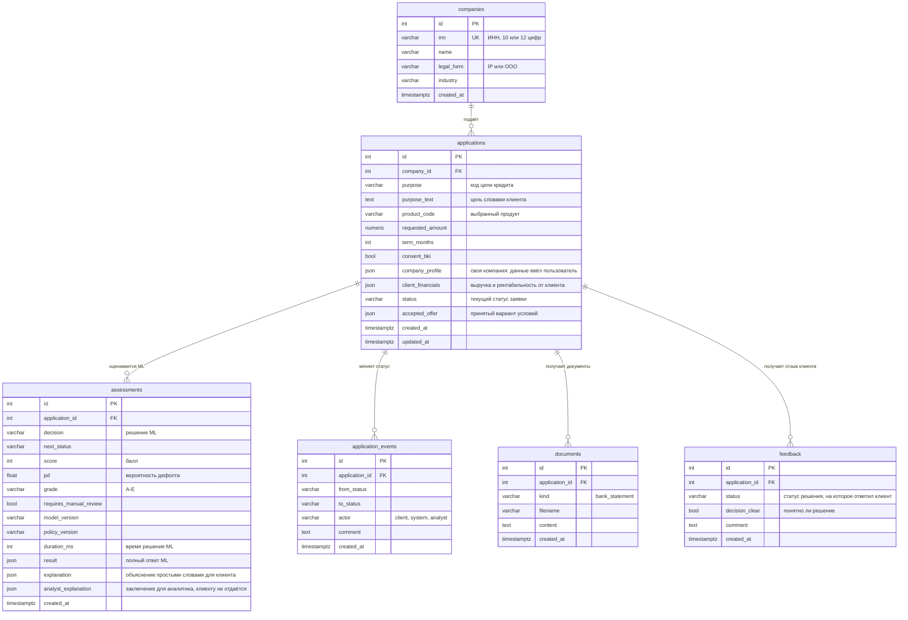

# Модель данных

Решение хранит данные в PostgreSQL в 6 таблицах. Схему создают миграции
`migrations/versions/0001_initial.py` … `0005_analyst_explanation.py`, описание в коде — `src/app/models.py`.

## Таблицы

| Таблица | Что хранит | Когда появляется запись |
|---|---|---|
| `companies` | компания-заявитель: ИНН, название, форма, отрасль | при первой заявке компании; данные берутся из мока ЕГРЮЛ |
| `applications` | заявка: что просит клиент и текущий статус; для своей компании — введённые данные (`company_profile`) | клиент нажал «Отправить заявку» |
| `assessments` | каждый прогон заявки через ML: решение, балл, грейд, полный ответ модели; объяснение простыми словами (`explanation`) | при подаче заявки и после каждой дозагрузки данных; `explanation` — когда клиент нажал «Объяснить» |
| `application_events` | история статусов: из какого в какой, кто и почему | при каждой смене статуса |
| `documents` | документы клиента (выписка по счёту) | клиент загрузил выписку |
| `feedback` | ответ клиента «понятно ли, почему банк так решил» | клиент ответил на вопрос под решением |

## Почему так

- **Оценок у заявки может быть несколько.** Например, сначала «нужны данные», а после выписки — «одобрено». Старые оценки не перезаписываются, поэтому видно, как менялось решение.
- **История статусов — отдельная таблица.** Так всегда понятно, кто перевёл заявку (клиент, система или аналитик), когда и с каким комментарием. Это нужно для аудита.
- **Полный ответ ML хранится в `assessments.result`.** Экран показывает решение ровно таким, каким его выдала модель в тот момент, даже если модель потом обновится. Ключевые поля (балл, PD, грейд, версия модели) вынесены в колонки для поиска и отчётов.
- **Своя компания хранится в заявке (`applications.company_profile`).** При дозагрузке данных заявка пересчитывается на тех же введённых цифрах. В `companies` для неё только ИНН и название.
- **Объяснение привязано к оценке (`assessments.explanation`).** Новое решение — новое объяснение. Внутри: текст, кто написал (`llm` или `template`), модель и список фактов, которые видела модель. Заключение для аналитика лежит в отдельной колонке `analyst_explanation`, чтобы клиентский API его не отдавал.
- **Суммы — `numeric(14, 2)`,** а не дробные числа: деньги не должны терять копейки при округлении.
- **Удаление каскадное:** при удалении заявки удаляются её оценки, история и документы.

## Что лежит в `assessments.result`

Ответ ML-модуля по схеме `AssessResponse` (`src/credit_ml/schemas.py`). Главные поля:

| Поле | Содержание |
|---|---|
| `decision`, `decision_label` | решение: APPROVE, COUNTER_OFFER, ALTERNATIVE_PRODUCT, REQUEST_INFO, MANUAL_REVIEW, DECLINE |
| `offer`, `offers` | предложенные условия: продукт, сумма, срок, ставка, платёж, DSCR |
| `risk` | балл, вероятность дефолта, грейд |
| `reasons`, `advice` | причины решения и советы клиенту |
| `checks` | результат каждой проверки (статус в ЕГРЮЛ, БКИ, стоп-факторы, скоринг, DSCR) |
| `missing_data` | каких данных не хватает |
| `manual_review_flags` | почему нужна ручная проверка |
| `features` | признаки, на которых считала модель |

Статусы заявки и переходы между ними — в README, раздел «Статусы заявки».
